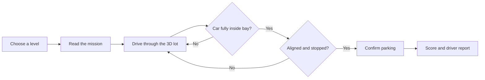
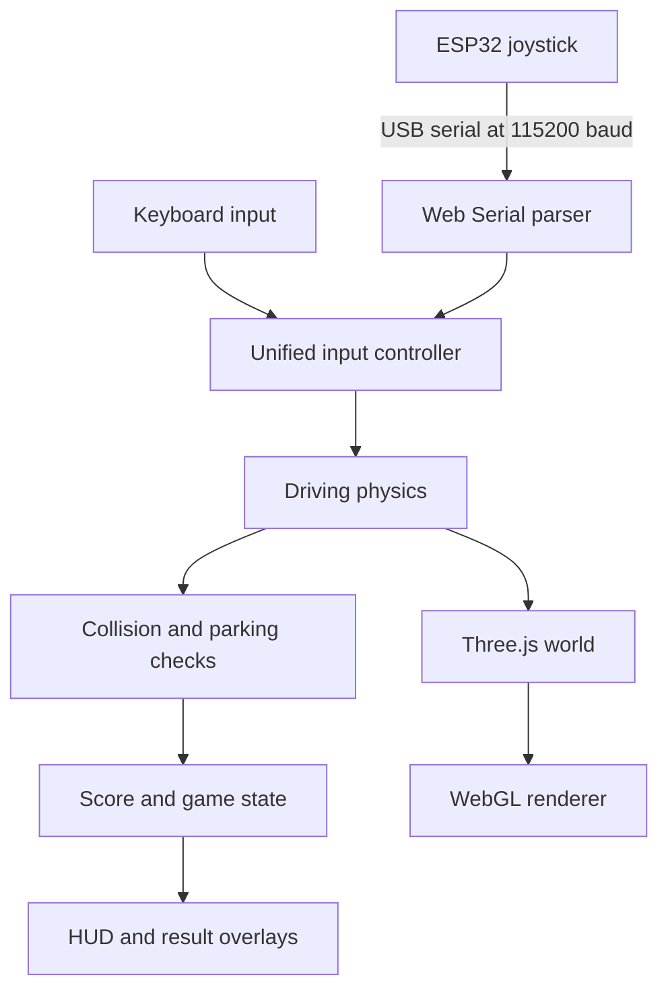

<div align="center">

# PARKLAB 3D

### A realistic desktop parking simulator for keyboard and ESP32 joystick control

<p>
  Learn acceleration, steering, braking, spatial awareness, and precision parking<br />
  inside a fully rendered 3D driving environment.
</p>

[](https://threejs.org/)
[](https://www.typescriptlang.org/)
[](https://vite.dev/)
[](https://www.espressif.com/)


<br />

[Explore features](#experience) &nbsp;|&nbsp; [Quick start](#quick-start) &nbsp;|&nbsp; [Controls](#controls) &nbsp;|&nbsp; [Connect ESP32](#esp32-joystick) &nbsp;|&nbsp; [Troubleshooting](#troubleshooting)

</div>

---

> **PARKLAB 3D** turns a classroom joystick project into a complete driving experience. The parking lot, cars, buildings, trees, lighting, obstacles, shadows, and cameras are real Three.js scene objects rather than a flat CSS illustration.

## At a glance

| 3D world | Driving model | Challenges | Hardware |
| :---: | :---: | :---: | :---: |
| Procedural parking campus | Acceleration, reverse, steering, braking, and collisions | 3 progressively harder parking missions | Keyboard or optional ESP32 joystick |
| Dynamic shadows and lighting | Wheel steering and rotation | Live validation, scoring, and driver report | Web Serial at 115200 baud |

## Experience

- **Real 3D environment** with a large parking lot, road markings, curbs, barriers, planters, buildings, trees, streetlights, and parked traffic.
- **Detailed player car** with a shaped cabin, grille, number plates, handles, headlights, rolling wheels, and visible front-wheel steering.
- **Responsive driving physics** with smooth acceleration, braking, reverse, coasting, collision response, and speed-sensitive steering.
- **Two useful cameras**: a close chase view for driving and an overhead view for planning the route.
- **Three missions** covering straight parking, route planning, and a reverse-bay finish.
- **Live dashboard** for speed, gear, steering, score, time, parking progress, connection state, and current objective.
- **Atmospheric presentation** with procedural asphalt, fog, tone mapping, shadows, engine audio, and illuminated parking targets.
- **Complete game loop** with pause, restart, penalties, success validation, level results, and a final driver report.



## Quick start

### 1. Install and run

```powershell
npm install
npm run dev
```

Open the local address printed by Vite. Use a desktop or laptop display at least **960 pixels wide**.

### 2. Create a production build

```powershell
npm run typecheck
npm run build
npm run preview
```

The optimized site is written to `dist/`.

<details>
<summary><strong>What do I need?</strong></summary>

<br />

- A current desktop browser with WebGL 2
- Node.js and npm for local development
- A keyboard, or an ESP32 analog joystick for hardware control
- Chrome or Edge on `localhost` or HTTPS when using Web Serial

This project intentionally targets desktop play. Smaller screens display a desktop-required notice instead of compressing the simulator.

</details>

## Controls

### Keyboard

| Key | Action |
| :---: | --- |
| `Arrow Up` | Accelerate forward |
| `Arrow Down` | Brake, then reverse |
| `Arrow Left` / `Arrow Right` | Steer the front wheels |
| `Space` | Confirm parking |
| `C` | Switch between chase and overhead cameras |
| `M` | Toggle engine and feedback audio |
| `Esc` | Pause or resume |

### ESP32 joystick

| Stick input | Action |
| :---: | --- |
| Up | Drive forward |
| Down | Brake, then reverse |
| Left / Right | Turn while applying forward drive |
| Diagonal | Keep forward or reverse drive while steering |
| Center | Release throttle and steering |
| Press | Confirm parking |

> Joystick left and right include forward throttle, so the car actually drives through the turn without requiring the stick to be held upward. Keyboard steering remains independent: hold `Arrow Up` or `Arrow Down` while steering.

## The three challenges

| Level | Mission | Skill focus |
| :---: | --- | --- |
| **01 - Precision arrival** | Park cleanly in the illuminated bay | Throttle and braking control |
| **02 - Cross-lot approach** | Navigate around the central barrier and find the open lane | Route planning and alignment |
| **03 - Reverse bay finish** | Reverse between two parked cars | Slow-speed reverse steering |

### Parking successfully

To complete a level, the whole car must be:

1. Inside the illuminated parking bay
2. Aligned with the bay
3. Completely stopped
4. Moving in the required direction on the reverse challenge

Press `Space` or the joystick button to confirm. Holding a valid parked position for one second also completes the level.

## Scoring

| Event | Score change |
| --- | :---: |
| Start each level | **100** |
| Successful parking | **+50** |
| Obstacle impact | **-20** |
| Outer curb contact | **-10** |
| Maximum three-level total | **450** |

## ESP32 joystick

The included firmware targets an original **ESP32 DevKit / ESP32-WROOM** board.

### Wiring

| Joystick pin | ESP32 pin | Purpose |
| :---: | :---: | --- |
| `VCC` / `+` | **3.3V** | Power - do not use 5V |
| `GND` | `GND` | Ground |
| `VRx` | **GPIO 35** | Horizontal axis |
| `VRy` | **GPIO 34** | Vertical axis |
| `SW` | **GPIO 27** | Joystick push button |

<details open>
<summary><strong>Upload and connect</strong></summary>

<br />

1. Open [`esp32/esp32_joystick/esp32_joystick.ino`](esp32/esp32_joystick/esp32_joystick.ino) in Arduino IDE.
2. Select the correct ESP32 board and serial port.
3. Keep the joystick centered, then upload the sketch. Startup calibration samples the resting position.
4. Close Arduino Serial Monitor so the browser can claim the port.
5. Run PARKLAB in Chrome or Edge and select **Connect ESP32**.
6. Choose the ESP32 port in the browser prompt.

</details>

<details>
<summary><strong>Serial protocol and analog mode</strong></summary>

<br />

The firmware sends one command every 50 ms at **115200 baud**:

```text
UP
DOWN
LEFT
RIGHT
CENTER
BUTTON
```

Set `SEND_ANALOG` to `true` in the Arduino sketch to send full axis data:

```text
X:512,Y:240,B:0
```

`X` and `Y` range from 0 to 1023. The browser normalizes them to -1 through 1 with a 15% center dead zone.

</details>

<details>
<summary><strong>Reverse an incorrect axis</strong></summary>

<br />

Change either flag near the top of the Arduino sketch, then upload it again:

```cpp
const bool INVERT_X = true; // Swap left and right
const bool INVERT_Y = true; // Swap forward and reverse
```

</details>

## How it works



The simulation uses `x` for left/right, `y` for height, and `z` for forward/back movement. Typed 2D footprints keep collision and parking checks predictable while Three.js renders the full 3D world.

<details>
<summary><strong>Project structure</strong></summary>

```text
joystick-parking-simulator/
|-- index.html                  Desktop simulator shell and overlays
|-- package.json               Scripts and dependencies
|-- tsconfig.json              Strict TypeScript configuration
|-- vite.config.ts             Development and production settings
|-- src/
|   |-- main.ts                Game state, physics, scoring, and UI
|   |-- world.ts               Scene, models, lighting, and cameras
|   |-- levels.ts              Three parking challenge layouts
|   |-- input.ts               Keyboard and serial input controller
|   |-- serial.ts              Web Serial connection and parser
|   |-- audio.ts               Procedural engine and feedback audio
|   |-- styles.css             Desktop HUD, menus, and visual system
|   `-- types.ts               Shared game types
`-- esp32/
    `-- esp32_joystick/
        `-- esp32_joystick.ino  Optional controller firmware
```

</details>

## Technology

| Technology | Role in PARKLAB |
| --- | --- |
| [Three.js](https://threejs.org/) | Real-time WebGL scene, meshes, lighting, shadows, fog, and cameras |
| [TypeScript](https://www.typescriptlang.org/) | Strict game logic, physics, state, and typed level data |
| [Vite](https://vite.dev/) | Fast local development and optimized production builds |
| [Web Serial API](https://developer.mozilla.org/en-US/docs/Web/API/Web_Serial_API) | Optional USB communication with the ESP32 |
| [Web Audio API](https://developer.mozilla.org/en-US/docs/Web/API/Web_Audio_API) | Generated engine and feedback sounds |

No downloaded 3D models or image textures are required. The vehicles, environment, parking markings, asphalt, and lighting are generated in code.

## Troubleshooting

<details>
<summary><strong>The 3D scene is blank or slow</strong></summary>

<br />

- Update the graphics driver.
- Enable browser hardware acceleration.
- Confirm that WebGL 2 is enabled at [webglreport.com](https://webglreport.com/?v=2).
- Close other graphics-heavy browser tabs.

</details>

<details>
<summary><strong>The Connect ESP32 button is disabled</strong></summary>

<br />

Web Serial is available in desktop Chrome and Edge and requires a secure context. Use `localhost` during development or HTTPS when deployed.

</details>

<details>
<summary><strong>The ESP32 does not appear in the port chooser</strong></summary>

<br />

- Use a USB cable that supports data, not a charge-only cable.
- Install the USB-to-serial driver required by the ESP32 board.
- Close Arduino Serial Monitor and any other app using the same port.
- Disconnect and reconnect the board, then try again.

</details>

<details>
<summary><strong>The car moves in the wrong direction</strong></summary>

<br />

Set `INVERT_X` or `INVERT_Y` in the firmware to `true`, upload again, and keep the stick centered during startup calibration.

</details>

<details>
<summary><strong>The car continues moving after a serial interruption</strong></summary>

<br />

Serial commands automatically expire. Reconnect the controller or press a keyboard driving key to take control immediately.

</details>

## Development commands

| Command | Purpose |
| --- | --- |
| `npm run dev` | Start the Vite development server |
| `npm run typecheck` | Check TypeScript without emitting files |
| `npm run build` | Type-check and create the production bundle |
| `npm run preview` | Preview the production build locally |

---

<div align="center">

**Build control. Read the road. Park with precision.**

Made as an interactive 3D learning experience for desktop browsers.

[Back to top](#parklab-3d)

</div>
